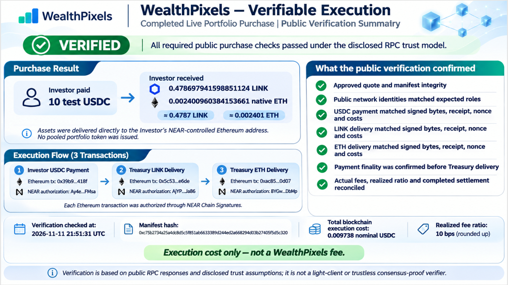

# WealthPixels

**Diversification Without Pooling.**

**Ownership Without Blockchain Boundaries.**

**Investing Without Barriers.**

WealthPixels aims to make diversified portfolios of individually owned assets as convenient
to purchase as units in a traditional investment fund. The Investor receives the individual
eligible underlying assets directly, rather than a portfolio token representing a claim on
pooled assets. Treasury principal inventory supplies the assets.

The long-term vision includes portfolios containing many eligible assets, potentially across
multiple blockchain ecosystems. The completed prototype demonstrates a two-asset purchase
on Ethereum Sepolia, authorized through NEAR Testnet Chain Signatures.

**Verifiable Execution** is a supporting product principle: independently checkable evidence
connecting approved purchase terms, payment, transaction authorizations, individual asset
deliveries and settlement. The current checks rely on disclosed public RPC trust assumptions
and local approval records.

For an optional narrative, read the
[**WealthPixels Guided Purchase Journey — Judge Story**](docs/WealthPixels_Hackathon_Demo_Story.md).
Its ten chapters follow the Investor from portfolio selection through payment, direct asset
delivery and Verifiable Execution. The separate
[technical Operator Story](docs/WealthPixels_Guided_Purchase_Operator_Story.md) preserves the
execution and approval procedures. You can evaluate this repository directly using the
commands below without reading either story first.

## What We Built for the NEAR Hackathon

The new TypeScript purchase coordinator connects:

- NEAR Chain Signatures for Ethereum transaction authorization, using separately authorized
  Investor and Treasury NEAR accounts and their derived Ethereum addresses.
- Stablecoin-funded portfolio purchases with exact quotes, integer asset quantities,
  principal inventory reservations and execution-cost eligibility checks.
- Direct LINK and native ETH delivery, sequential settlement, durable payment claims,
  explicit transaction approvals and bounded recovery controls.
- Public transaction evidence and an independent verifier linking the approved purchase
  to its authorizations, payment, individual deliveries, balances and execution costs.

The present implementation uses **NEAR Testnet and Ethereum Sepolia**. Both delivered assets
remain on Sepolia; multi-destination-chain delivery, broader portfolios, tokenized securities
and production custody/pricing remain future work.

The disclosed demonstration model permits one operator to control both disposable testnet
roles. Separate accounts and authorizations demonstrate protocol behavior without establishing
independent production custody.

## Completed Live Portfolio Purchase

Completed November 11, 2026, with a 50% native ETH / 50% LINK allocation:

| Recorded result | Value |
| --- | --- |
| Investor payment | **10 test USDC** |
| LINK delivered | **0.478697941598851124 LINK** |
| Native ETH delivered | **0.002400960384153661 ETH** |
| Purchase ID | `guided-purchase-20261111-003` |
| Public verification | **VERIFIED — exit 0; seven verification groups passed** |
| Total blockchain execution cost | **0.009738 nominal USDC**, rounded up using approved demonstration prices |

This execution cost is **not a WealthPixels platform fee**. The purchase completed with no
outstanding delivery obligation. Verification at **2026-11-11T21:51:31.505Z** included historical
payment finality before LINK delivery.

**Visual summary of the saved November 11, 2026 VERIFIED result**

[](docs/WealthPixels_Verifiable_Execution_Summary.png)

[Open the image at full size](docs/WealthPixels_Verifiable_Execution_Summary.png).
Later independent reruns may be **incomplete** when required historical Beacon data is
unavailable; each rerun must retrieve its own evidence.

The original [completed purchase manifest](evidence/guided-purchase-20261111-003.json) and
[successful saved verification report](evidence/guided-purchase-20261111-003-verification-001.json)
remain the **authoritative evidence**. See the [public evidence documentation](evidence/README.md).
The manifest preserves all three
NEAR authorization hashes and all three Ethereum transaction hashes; the Judge Story's
[transaction table](docs/WealthPixels_Hackathon_Demo_Story.md#chapter-10--hackathon-evidence-and-verification)
also lists them.

The exact approved quote hash is:

```text
0x12f47956df63129eeb2ae6a8f388f2274e777ee5d62f0eb395f0cc21bfeda4a1
```

## Quick Evaluation — No Credentials Required

This is the primary evaluation path for hackathon judges and technical reviewers.
**No Investor or Treasury signing credentials, private keys, funded testnet accounts or
transaction approvals are required.**

### Prerequisites and offline evaluation

Use **Node 22.23.4**, pinned in [.node-version](.node-version), or a supported Node 22 patch
**>=22.22.2 <23**, and npm. From the repository root:

```bash
npm ci
npm test
npm run typecheck
npm run purchase:dry-run
```

These commands work on Windows, macOS and Linux. Installation needs internet or a populated
npm cache. The tests and purchase dry-run use offline fixtures without RPC calls or
Windows-specific setup.

Expected results:

- Tests pass and TypeScript validation exits 0.
- The dry-run reports `finalStatus: "completed"`, no outstanding fixture obligations,
  three simulated NEAR submissions and three simulated Ethereum submissions.

The dry-run uses an isolated temporary journal and synthetic prices, approvals, signatures,
broadcasts, balances and receipts. Its quantities differ from the live purchase.
**Simulation output is separate from the recorded live transactions and proves no asset delivery.**

The saved November 11 packaging validation passed **667/667 tests**, TypeScript validation
and the three-leg fixture dry-run. These are recorded results, separate from the public
verification of the completed live purchase.

### Independently verify the recorded live purchase

Run this exact command to select the completed manifest and pin the approved quote:

```bash
npm run verify:purchase -- --manifest evidence/guided-purchase-20261111-003.json --expected-quote-hash 0x12f47956df63129eeb2ae6a8f388f2274e777ee5d62f0eb395f0cc21bfeda4a1 --near-rpc https://archival-rpc.testnet.fastnear.com --evm-rpc https://rpc.sepolia.ethpandaops.io --beacon-rpc https://ethereum-sepolia-beacon-api.publicnode.com
```

This reads public data without signing or broadcasting. It omits `--report` to preserve
the saved report. The verifier's default historical pending manifest is separate from
this completed purchase, so retain the explicit `--manifest` argument.

| Exit code | Meaning |
| --- | --- |
| **0** | Verified: every required public check passed, including all seven groups. |
| **2** | Incomplete: required history is unavailable or evidence is pending. |
| **1** | Invalid or contradictory evidence, a CLI error or an input/output failure. |

Public verification requires compatible NEAR, Ethereum execution and Beacon historical
data. Public services may prune history, rate limit requests or become unavailable.
The successful saved report does not guarantee future retrieval; a new run must obtain
its own evidence. Configurable endpoints change data providers, not the checks.

Verification trusts RPC responses and disclosed operator assertions for approval references,
original gas estimates and local quote/payment association. It checks Beacon header roots
but does not verify BLS consensus signatures or BeaconState/body Merkle proofs, and is not
a light client. See the [verification limits](evidence/README.md#portfolio-purchase-manifest-and-public-verifier).

## Architecture at a Glance

All three Ethereum transactions are authorized through NEAR Chain Signatures:

1. **Investor transfers USDC to Treasury.** The coordinator verifies canonical finalized
   payment and durably claims its identity before permitting Treasury delivery.
2. **Treasury delivers LINK directly to Investor** from principal inventory.
3. **Treasury delivers native ETH directly to Investor**, using a fresh nonce after
   LINK confirmation.

Settlement is **sequential and non-atomic**. After accepted payment, quote expiry or rising
fees do not cancel the remaining delivery obligations. Uncertain attempts require
reconciliation; recovery preserves the approved transaction identity.

The immutable quote binds the exact investment, 50/50 allocation, asset quantities, approved
demonstration prices, public destinations and six expected costs: three Ethereum executions
and three NEAR MPC signing operations. Expected execution costs must be at most **10%**
of the investment. This economic eligibility threshold is **not a platform fee** and does
not establish production economic viability.

Pricing uses explicitly approved demonstration observations through a replaceable
`PriceProvider` interface. It does not use production market feeds. Current quote acceptance
and execution-observation freshness are separate deadlines; the
[Operator Story](docs/WealthPixels_Guided_Purchase_Operator_Story.md) explains the full
transaction lifecycle, separate signing/broadcast approvals and recovery procedures.

## Pre-existing Work and Hackathon Contribution

WealthPixels builds on a pre-existing portfolio purchasing concept and Solidity proof of concept designed to demonstrate stablecoin-funded purchases of individual digital assets from pre-funded inventory, without issuing shares in a pooled portfolio.

The original Solidity implementation was limited to assets available on its host blockchain, typically requiring wrapped or bridged representations to incorporate assets native to other networks. Recognizing that NEAR Chain Signatures could enable transaction authorization across multiple blockchains, while allowing assets to remain on their native networks, was a key motivation for exploring NEAR and participating in the November 2026 hackathon.

During the hackathon, we developed a new TypeScript-based execution architecture incorporating NEAR Chain Signatures, separately authorized Investor and Treasury accounts, portfolio purchase coordination, settlement and recovery controls, and independent public execution verification. The completed prototype demonstrates a 10-test-USDC purchase delivering native ETH and LINK on Ethereum Sepolia. Multi-destination-chain delivery remains a future objective.

**The original Solidity contracts and tests are preserved in the repository but were not used in the demonstrated ETH and LINK portfolio purchase.**

Read the expanded
[**Pre-existing Work, Architectural Evolution and Hackathon Contribution**](docs/WealthPixels_Hackathon_Demo_Story.md#pre-existing-work-architectural-evolution-and-hackathon-contribution)
for the motivation behind selecting NEAR and the evolution from the original concept.

## Technical Documentation

| Topic | Documentation |
| --- | --- |
| Investment proposition and ten-chapter demonstration | [Guided Purchase Journey — Judge Story](docs/WealthPixels_Hackathon_Demo_Story.md) |
| Technical execution and approval checkpoints | [Guided Purchase Operator Story](docs/WealthPixels_Guided_Purchase_Operator_Story.md) |
| Evidence schemas, public verification and trust limits | [Public evidence guide](evidence/README.md), [completed manifest](evidence/guided-purchase-20261111-003.json), [Task 03E report](docs/Task03E_Public_Purchase_Evidence_and_Verification.md) |
| Exact allocation, USDC/LINK intents and fee eligibility | [Task 03B](docs/Task03B_ERC20_Intents_and_Fee_Eligibility.md) |
| Native ETH and pricing research | [Task 03C](docs/Task03C_Native_ETH_and_Pricing_Readiness.md) |
| Price approval, immutable quotes and prepayment | [Task 03D-1](docs/Task03D1_Quotation_and_Prepayment.md) |
| Purchase execution, settlement and recovery | [Task 03D-2](docs/Task03D2_Purchase_Execution_and_Recovery.md), [readiness corrections](docs/Portfolio_Purchase_Readiness_Corrections_20261110.md) |
| NEAR integration, derivation and role setup | [Task 02A](docs/Task02A_NEAR_Integration_Preparation.md), [Task 02B-1](docs/Task02B1_Account_Setup_and_Derivation.md) |
| Earlier transfers and bounded recovery | [Task 02B-2A](docs/Task02B2A_Live_Transfer_Implementation.md), [Treasury recovery](docs/Task02B2B_Phase3F_Controlled_Broadcast_Recovery.md), [Investor recovery](docs/Task02B2B_Phase3H_Investor_Recovery_Readiness.md) |
| Native smoke test, signing observability and diagnostics | [Task 03F-A](docs/Task03FA_Native_Test_and_Live_Readiness.md), [Task 03F-B1](docs/Task03FB1_Signing_Observability.md), [Experiment A](docs/ExperimentA_Implementation_Report.md), [Experiment B](docs/ExperimentB_Implementation_Report.md) |
| Moved implementation context, pricing directions and legacy tooling | [Development reference](docs/WealthPixels_Development_Reference.md) |
| Publication and submission work | [Hackathon submission checklist](docs/WealthPixels_Hackathon_Submission_Checklist.md) |

Task reports preserve their historical increment boundaries. For current timing and
approval procedures, use the Operator Story and
[current live operator runbook](docs/Task03FA_Live_Operator_Runbook.md).

Earlier two-way LINK transfers, the native ETH smoke test and diagnostic experiments remain
separate capability evidence, accessible through the public evidence guide.

## Optional Advanced Live Reproduction

A new live purchase requires separately provisioned, independently controlled disposable
testnet identities, funded accounts and private signing credentials held outside this
repository. The current adapter pins the reviewed demonstration identities; different
identities require a separately reviewed public configuration adaptation and derivation checks.

Follow the [Operator Story](docs/WealthPixels_Guided_Purchase_Operator_Story.md) and
[live operator runbook](docs/Task03FA_Live_Operator_Runbook.md), with the
[account setup guide](docs/Task02B1_Account_Setup_and_Derivation.md) and
[Windows operator guide](docs/Task02B1_Windows_Operator_Instructions.md) as setup references.

Price approval, quote preparation/approval, payment preparation, each MPC signing request
and each broadcast remain distinct checkpoints. Signing approval binds an exact unsigned
digest; broadcast approval binds the exact signed transaction hash. Prior purchases and
their expired approvals supply no authorization for a new one.

<a id="reproducibility-and-source-history"></a>

## Reproducibility, Licensing and Development History

The imported pre-existing baseline is
`8e38b987d7dd3a373a1bb1f003bb575d12b0ec8b`, committed **November 1, 2026**
(Toronto time). The original contract-custodied 60/40 USDC-to-WETH/WBTC implementation is
identified as 2024 work in the
[original-code assessment](docs/WealthPixels_NEAR_Codebase_Assessment_and_Codex_Kickoff.md).
The import date does not establish when that code was authored. The contracts, original
portfolio test and Hardhat configuration are unchanged since the imported baseline.

NEAR integration starts at `e332575412e167fa47090f62d3428fcc1a1b6e06` on
**November 2, 2026**. The November 2–11 implementation added the NEAR-authorized purchase
system, offline tests and public verification described above; it does not claim the
original Solidity implementation as new hackathon work.

Compare the imported baseline with this checkout:

```bash
git diff --stat 8e38b987d7dd3a373a1bb1f003bb575d12b0ec8b HEAD
git diff 8e38b987d7dd3a373a1bb1f003bb575d12b0ec8b HEAD -- src scripts test package.json
```

Review the [GitHub source comparison](https://github.com/RaymondLapointe/WealthPixels-NEAR-Hackathon-2026/compare/pre-hackathon...hackathon-submission).
The `pre-hackathon` base tag marks the imported pre-existing 2024 Solidity implementation;
the `hackathon-submission` head tag marks the November 2026 NEAR implementation and its
supporting evidence. The original Solidity contracts and portfolio test remain unchanged.

See the [release checklist](docs/WealthPixels_Hackathon_Submission_Checklist.md) and
[official hackathon rules](https://nearhackathon.com/HACKATHON.md) for submission preparation.

Reused dependencies/tooling are declared in [package.json](package.json) and locked in
[package-lock.json](package-lock.json): near-api-js 7.4.0, Ethers, Hardhat, OpenZeppelin,
Chainlink contracts, TypeScript/tsx, Mocha/Chai and dotenv. Existing WealthPixels code is the
baseline above; Codex assisted implementation, tests and documentation. Dependency licenses
remain their own.

**Licensing.** Copyright (c) 2026 2001456 Ontario Inc. The new November 2026
implementation and its supporting tests, scripts, documentation and copyrightable
WealthPixels evidence contributions use the
[WealthPixels Evaluation License 1.0](LICENSE), a custom source-available,
evaluation-only license. It permits viewing, cloning, installation, execution, testing,
purchase simulations, public-evidence verification and limited local changes needed for
evaluation. GitHub's applicable viewing/forking rights are preserved. General reuse,
modification, redistribution, sublicensing, product integration, production use and
commercial development require separate written authorization, except where another
applicable license or law permits them.

The five legacy Solidity files retain their MIT terms and existing notices;
[NOTICE](NOTICE) explains the scope and historical licensing, and
[LICENSES/MIT.txt](LICENSES/MIT.txt) supplies the MIT text. Company-owned inherited
non-Solidity material is available for evaluation, subject to prior grants.
Third-party portions, dependencies and public blockchain facts retain their applicable
rights. No previously valid license grant is withdrawn, and lawful independent development
of similar ideas remains unrestricted.

Package metadata is `"license": "SEE LICENSE IN LICENSE"`, matching the root lockfile entry;
dependency licenses are unchanged. Runtime journals, protected credentials and generated
dependencies remain excluded from Git.
